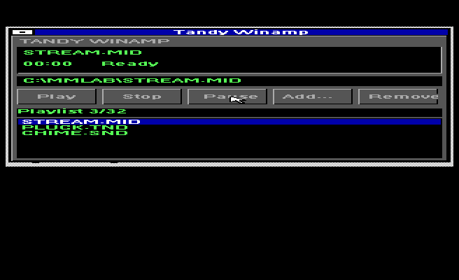
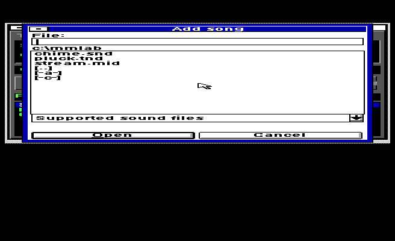

# OEMSound-Tandy

Music players and instruments for the **Tandy 1000 EX/HX** and Windows 3.0.

## Tandy Winamp

Browse your music, build a playlist, and play **MIDI, VGM/VGZ and tracker MOD
arrangements** through the Tandy PSG.

**[Download Tandy Winamp UX3](https://github.com/astrobleem/oemsound-tandy/releases/download/tandy-winamp-ux3.20261018/TWUX3.ZIP)**
 · [Install guide](experimental/WINAMP30/INSTALL.TXT)
 · [Release notes](https://github.com/astrobleem/oemsound-tandy/releases/tag/tandy-winamp-ux3.20261018)



*Current released UX3, captured in Windows 3.0 real mode with the qualified
320x200 color driver. [Genuine capture details](docs/SHOTS/WINAMPCL.MD).*

- **Browse/Add:** choose songs from the Windows file browser.
- **32-song playlist:** scroll past the visible rows or use Home, End and Page Up/Down.
- **Remove while playing:** change the list without deleting the song or stopping it.
- **A proper player window:** the title stays **Tandy Winamp**, with track and status inside.



*The same released app with its Add song browser open. The folder contains
original synthetic examples.*

On a real **Tandy 1000 EX at 7.16 MHz**, the owner accepted UX3 and reported
uninterrupted music while using Program Manager.
[Hardware report and test record](experimental/WINAMP30/EVIDENCE/PHYSICAL.JSON).

### Try it

Extract the ZIP's `TWUX3` folder to `C:\TWUX3`. With the matching existing
Windows 3.0 sound profile at `C:\W30SND`, exit Windows and run:

```dos
C:\TWUX3\TPLAY C:\W30SND /CHECK
C:\TWUX3\GO
```

Choose Add... to load your own supported files. Stop and close the player,
then exit Windows normally to return to DOS. The [install guide](experimental/WINAMP30/INSTALL.TXT)
covers the sound-profile prerequisites. The ZIP includes corresponding source,
notices and original synthetic examples.

MIDI uses the Tandy voices and basic percussion. VGM/VGZ preserves the supported
PSG register stream. MOD follows supported tracker pitch, volume and effects
using square-wave tones; it does not reproduce sample timbres.
[Supported formats](docs/FORMATS.MD) · [Playback timing](docs/SNDTIME.MD)

## Make five-voice music

**Fiddle and Beats** add an optional **PC-speaker square-wave voice** alongside
the PSG's **three tones and noise**. Write a fifth `[P]` part in MML3, or edit
and export the fifth lane in Beats.

**[Download MML3AUTH.ZIP](https://github.com/astrobleem/oemsound-tandy/releases/download/sound-exp-v0.1.0-pit.20261007/MML3AUTH.ZIP)**
 · [Authoring and setup](experimental/PITPUBLIC/INSTALL.TXT)

This is square-wave music, separate from sampled speaker speech. A separate
Winamp speaker-assist candidate has native validation; it is not in the UX3
download. The [engineering note](docs/SPEAKER.MD) explains its scope and progress.

## Build your own Windows music app

**[libwintandy](https://github.com/astrobleem/libwintandy)** shares the 8086
Windows MIDI services, prepared-frame/ordered-burst playback backend and USER
UI helpers. Its VGM, gzip and MOD readers and foreground integration are
available as source with working examples.

Start with **[FORMATS30](https://github.com/astrobleem/libwintandy/tree/24ff4f932c0d4d4e2a18a3c49b0ea0a8ff90e71f/examples/FORMATS30)**,
then follow the [build guide](experimental/WINAMP30/BUILDING-UI.MD) and
[API/format boundaries](docs/FORMATS.MD#reuse-and-evidence). The playlist and
Browse/Add/Remove UI belong to Winamp; `TPLAY` is its guarded DOS launcher.

For separate source-only DOS and portable C89 Tandy components, see
[libtandy](https://github.com/astrobleem/libtandy). It covers SN76489-family PSG
state, graphics, surfaces, input and cooperative timing; the Windows driver and
apps here remain separate projects.

## More to play with

- **[Mini Piano](src/win30/PIANO/README.MD)** — play notes with the keyboard or mouse.
- **[JOYMIDI](src/win30/JOYMIDI/README.MD)** — turn a joystick into a pitch/velocity instrument.
- **[Beats Lab](artifacts/win30/BEATS/README.MD)** — build patterns on a four-lane step sequencer.
- **[Buddy Holly: BUDCAP video with PSG music and timed captions](https://youtu.be/wzUQWxt3Eno)** — an offline export. [BUDCAP 0.4 docs](examples/BUDDY/BUDCAP/README.md) describe the 256×160 DOS video at 4 fps. [Watch the genuine emulator demo GIF](docs/SHOTS/BUDCAP04.GIF)
  · [Capture details](docs/SHOTS/README.MD#budcap-04-animated-preview).
- **[Blondie's "Call Me" five-channel oscilloscope](https://youtu.be/gpdcfCYBdpk)** — an offline visualization
  of the Tandy PSG and PC-speaker arrangement.

See [validation](experimental/WINAMP30/VALIDATION-UI.MD),
[checksums](https://github.com/astrobleem/oemsound-tandy/releases/download/tandy-winamp-ux3.20261018/SHA256SUMS)
and component notices for exact versions and scope. Winamp and the
[Windows XT display project](https://github.com/astrobleem/oemdisplay-tandy)
have separate release gates.

## Licensing

Keep the [root license](LICENSE) and component-specific notices. Winamp/shared
source and the first-party browser retain their MIT notices; TSOUND has its own
license. The Winamp package includes no private/commercial music, sample media,
Windows, ROMs or proprietary tools. BUDCAP's existing media has separate rights
and is not included in the Winamp download.
