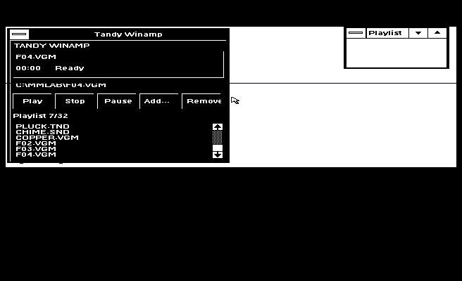
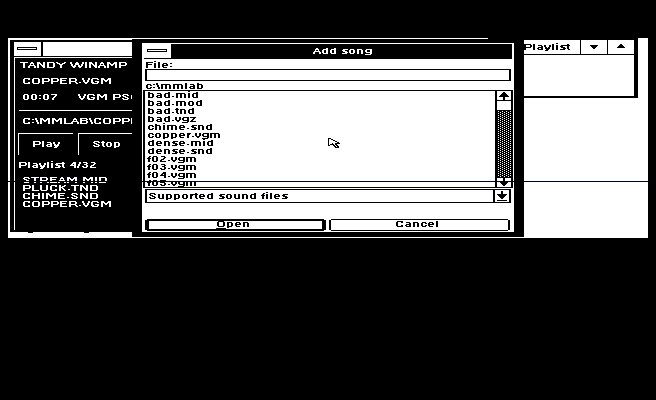

# OEMSound-Tandy

**Tandy Winamp for the Tandy 1000 EX/HX:** MIDI, supported VGM/VGZ streams and
PSG-adapted MOD music in Windows 3.0 real mode. Three square-wave tone voices
and one noise voice, with queued playback that leaves Windows usable.

The wider project also has an **optional fifth square-wave speaker voice** and
**MML3 authoring in Fiddle and Beats**, available in the separate public PIT
sound kits. [Shared playback and format code](#build-another-windows-app-with-libwintandy)
is available for your own 8086 Windows apps.

**[Download Tandy Winamp UX3](https://github.com/astrobleem/oemsound-tandy/releases/download/tandy-winamp-ux3.20261018/TWUX3.ZIP)**
 · [Release notes and checksums](https://github.com/astrobleem/oemsound-tandy/releases/tag/tandy-winamp-ux3.20261018)
 · [Install guide](experimental/WINAMP30/INSTALL.TXT)
 · [Shared Windows library: libwintandy](https://github.com/astrobleem/libwintandy)



*Actual, unmodified emulator capture: the playlist reaches beyond four songs,
with Play, Stop, Pause, Add... and Remove visible. Windows 3.0 real mode, stock
CGA, 8088 test fixture. [Capture provenance](docs/SHOTS/WINAMP3.MD).*

## What you can do

- **Browse and add music.** Add... opens the application-local Windows 3.0 file
  browser, with filters for MID, VGM, VGZ, MOD, TND and SND. Cancel leaves the
  list intact; adding a duplicate selects its existing row.
- **Keep a 32-entry session playlist.** Scroll past the visible rows or use
  Home, End, Page Up and Page Down. Paths use DOS 8.3 names, up to 127 bytes.
- **Remove an entry without deleting its file.** Removing the playing row
  leaves that song running until Stop, EOF or another Play.
- **Keep Windows responsive while music plays.** Queued sound output continues
  while the app refills in the foreground. In the native test, playback advanced
  through a visibly open file dialog and active-row removal.
- **See a consistent title.** The caption stays **Tandy Winamp**; the track,
  elapsed time and playback status appear inside the window.

The owner accepted UX3 on a real **Tandy 1000 EX, 7.16 MHz 8088**, after being
asked to try Browse/Add, Remove and scrolling past four songs: **“that worked
great publish it.”** The owner also reported uninterrupted music while using
Program Manager. These are qualitative observations on that setup, without
measured jitter or a promise about every application or workload.
[Acceptance scope and runtime identity](experimental/WINAMP30/EVIDENCE/PHYSICAL.JSON).



*Actual emulator capture of the visible modal browser during playback. The
test directory contains original synthetic fixtures. This is separate from the
owner's physical-hardware report. [Validation](experimental/WINAMP30/VALIDATION-UI.MD).*

## Download, install and run

1. Download **[TWUX3.ZIP](https://github.com/astrobleem/oemsound-tandy/releases/download/tandy-winamp-ux3.20261018/TWUX3.ZIP)**
   and extract its `TWUX3` folder to `C:\TWUX3`. Keep the runtime EXE/DLL files
   together; `SRC` and `DEPS` contain corresponding source and build material.
2. Use an existing lawful **Windows 3.0 real-mode** installation with the
   matching qualified sound profile. The physically accepted setup uses
   `C:\W30SND`, stock CGA and the pinned TSOUND driver. Windows and system
   drivers are not included. Read the [profile prerequisites](experimental/WINAMP30/INSTALL.TXT).
3. Exit Windows completely. From DOS, check the profile, then launch:

   ```dos
   C:\TWUX3\TPLAY C:\W30SND /CHECK
   C:\TWUX3\GO
   ```

Use Add... to choose your own supported files. Stop and close the player, then
exit Windows normally to return to DOS and let the guarded launcher remove its
owned timer bridge. A refusal means the profile or ownership checks did not
match; follow the install guide before proceeding. No INI editor or system-wide
MIDI registration runs during app launch.

The download includes the already-public original `STREAM.MID`, `PLUCK.TND`,
`CHIME.SND` and synthetic `SHORT.VGM` examples. It includes source, notices,
per-file hashes and build instructions. Commercial/private songs, sample media,
Windows, fonts, ROMs, disk images and proprietary build tools are excluded.

## Five voices and MML3 authoring

The PSG supplies **three tone voices plus noise**. The separate
**[PIT sound kits](https://github.com/astrobleem/oemsound-tandy/releases/tag/sound-exp-v0.1.0-pit.20261007)**
add an explicitly enabled **PIT2 PC-speaker square-wave voice** alongside the
PSG in their supported clients. It has fixed on/off loudness, without an
independent hardware amplitude control. PIT music and sampled PWM speech are
mutually exclusive. Tandy Winamp UX3 keeps this optional speaker voice off;
five-voice output is not an automatic feature of every player or format.

**MML3 is implemented authoring support**, in the separate **MML3AUTH.ZIP**
Fiddle/Beats kit: Fiddle edits, opens, saves and plays explicit MML3 with a
`[P]` speaker part; Beats edits/exports its fifth lane as MML3, while its
PIT-off export preserves legacy MML2. Playback requires explicit opt-in and
the paired TSOUND capability. Its bounded profile uses notes 45–96, up to
8,192 source bytes, 4,096 notes/rests per part and 600 seconds; the speaker
part has no envelopes, presets, bends or ties. [Authoring and setup guide](experimental/PITPUBLIC/INSTALL.TXT).

These older kits retain their recorded emulator qualification and limitations;
the new UX3 physical report does not qualify their fifth-voice audio summing.
MML3's parser/editor belongs to those authoring apps. It is not a Winamp file
filter or an exported `libwintandy` MML3 loader. Winamp's current formats follow.

## Formats and boundaries

| Input | What plays | Main limits |
| --- | --- | --- |
| MIDI `.MID` | Bounded type 0/1 files rendered as Tandy PSG voices, with tempo changes and basic noise percussion | Up to 32 KiB and 16 tracks; supported message/note subset, not a General MIDI synthesizer |
| VGM / VGZ | Supported SN76496 register streams, preserving ordered writes and explicit noise retriggers | Strict Tandy chip profile, at most 60,000 uncompressed bytes and 16 writes per timestamp group |
| MOD | `M.K.` / `4CHN` tracker music arranged onto the three PSG tones | Supported effects and finetune zero; at most three audible lanes; sample timbres are not reproduced |
| TND / SND | The existing bounded Tandy and raw-sound paths | Follow each reader's format limits; arbitrary files are refused |

VGM accepts the documented SN command/wait subset with a 3,579,545 Hz clock,
feedback 6, 15-bit noise register and zero variant flags. Other sound chips,
stereo/data/PCM commands and unsupported variants are refused. VGZ validates
the gzip stream, CRC and output size. A supported VGM loop gets one bounded
repeat. MOD sample data is skipped; its pitch, volume and supported effects
drive square-wave substitutes. More than three audible lanes is refused.
VGM/VGZ/MOD have Pause/Resume; Play restarts and Stop/EOF release ownership.
[Full format, gzip, loop and refusal rules](https://github.com/astrobleem/libwintandy/blob/24ff4f932c0d4d4e2a18a3c49b0ea0a8ff90e71f/libtandywin/AUDIO/FORMATS30.MD).

## How playback timing works

File reads, parsing and synthesis happen in the foreground. Prepared sound
states or ordered register groups go into **RAWCLK's bounded queue**, and the
owned PIT-cycle scheduler emits them when due. The interrupt handler does no
file I/O, parsing, allocation or Windows calls. This is how queued playback can
continue while another cooperative Windows task handles UI.

The timing layers have different jobs:

- **Scheduled output:** prepared MIDI states have an 8 ms minimum spacing.
  VGM/MOD groups require at least 9,546 PIT cycles, the ceiling of 8 ms;
  VGM wait conversion and MOD tempo calculation retain fractional carry.
- **Foreground refill:** Windows USER service and the app message loop refill
  the queue on an approximately 55 ms cadence. MIDI instrument-envelope steps
  also retain their 55 ms quantum. The 55 ms refill interval is not the output
  timestamp resolution.
- **Bounded reserve:** the VGM/MOD path queues 512 groups, about 8.53 seconds
  at 60 Hz or 4.096 seconds at minimum spacing. Long foreground stalls can
  exhaust that reserve. Late data is an explicit failure; timing is not silently
  shifted to catch up.

This does not promise 1 ms scheduling, zero jitter, sample-accurate MOD audio
or uninterrupted output under every workload. Stop, EOF and ordinary close
mute and release the acknowledged sound owner. Pause/resume restores hardware
state and may restart noise; noise-phase continuity is not promised.
[Backend API and ownership](https://github.com/astrobleem/libwintandy/blob/24ff4f932c0d4d4e2a18a3c49b0ea0a8ff90e71f/libtandywin/AUDIO/BURST-API.MD).

## Build another Windows app with libwintandy

**[libwintandy](https://github.com/astrobleem/libwintandy)** is the shared
8086/Windows 3.0 code repository. Its historical directory is named `libtandywin`;
the repository name is `libwintandy`. The player is one consumer of these pieces.

| Reusable component | What another app can use |
| --- | --- |
| `LWTANDY.H` / `LTWUI` | Existing USER repaint and UI helpers |
| `LWAUDIO.H` | Declarations for the app-local MCI and raw-player facades; it is not a universal format-loader DLL |
| `MCITNDY` + `MIDICLK` | Bounded MIDI-file service and timestamped MIDI transport; `MciCommand`/`MciPump` and `MDOpen`/`MDPush`/`MDCommit`/`MDPump` are existing exported entry points |
| `RAWCLK` | Prepared PSG frames and negotiated ordered bursts through `TCBGetCaps`, `TCBOpen`, `TCBPush` and `TCBEnd`, using the shared owner and clock |
| Format source in `AUDIO/SOURCE` | Reusable foreground VGM/gzip/MOD readers and `FMTCORE`; `FMTAPP` is source integration to compile into a caller, not an exported all-format DLL |

Start with **[examples/FORMATS30](https://github.com/astrobleem/libwintandy/tree/24ff4f932c0d4d4e2a18a3c49b0ea0a8ff90e71f/examples/FORMATS30)**
for the format producers, or **[examples/PLAYER30](https://github.com/astrobleem/libwintandy/tree/24ff4f932c0d4d4e2a18a3c49b0ea0a8ff90e71f/examples/PLAYER30)**
for the earlier facade caller. Keep the pinned app-local DLL set and qualified
Windows sound profile together. Compile the selected format integration into
your app, service its foreground pump, and preserve FULL/retry, Stop/EOF and
acknowledged-close handling. Include your licensed Windows header before the
facade header. See the [source/build guide](experimental/WINAMP30/BUILDING-UI.MD).

The playlist, selection/path lifetime, Browse/Add/Remove commands and caption
policy belong to Tandy Winamp. `TPLAY` is a guarded DOS launch workflow, not a
public Windows library API. The Windows 3.0 file browser is a separate first-party
application-local `LWFILE.DLL`; it is not Microsoft's Windows 3.1 COMMDLG.

For MML3 source reuse, the separate [Fiddle parser header](experimental/PITPUBLIC/MML3AUTH/SOURCE/src/win30/MMLFIDL/MMLCORE.H)
defines `mml_validate`, `mml_reset` and `mml_next`; retain that component's
license and bounded-source lifetime rules. The optional fifth-voice
[TSOUND extension](experimental/PITPUBLIC/PITWIN/SOURCE/src/win30/DRIVER/PITAPI.H)
is discovered as `TANDYPITVOICE` only after acquiring `OpenSound`; it is not
an extra standard Windows SOUND voice or a `RAWCLK` frame field.

## What has been verified

UX3 passed **149 portable C89 checks**, **396 native UI checks**, and **88
independent gzip/PSG/refusal/EOF/ownership checks**. The native UI runs cover
Browse/Add/Cancel, duplicates and missing files, an eight-entry scrolling list,
keyboard navigation, continued playback through a visible modal browser,
active-entry removal, file preservation and clean Stop/close/DOS return.
The independent regression retains its exact PSG hash and write count.
[Results and measured allocation costs](experimental/WINAMP30/VALIDATION-UI.MD).

Native qualification used a disposable Windows 3.0 real-mode **Tandy HX 8088,
4.772728 MHz, 640 KiB, stock-CGA emulator fixture**. The owner separately accepted
the hash-matched UX3 app on the **physical Tandy 1000 EX at 7.16 MHz**. Neither
result qualifies PCjr audio, Windows 3.1/protected mode, every tracker effect or
every possible concurrent app. GitHub CI verifies pinned package inputs; it
does not compile Microsoft C/MASM or repeat native/hardware testing.

This publishes the **Tandy Winamp app update**. The separate
[Windows XT project](https://github.com/astrobleem/oemdisplay-tandy) still needs
its combined-driver testing before a new release candidate.

## More Tandy sound and video tools

- **Mini Piano and JOYMIDI:** [keyboard/mouse piano](src/win30/PIANO/README.MD)
  and [joystick instrument](src/win30/JOYMIDI/README.MD).
- **Beats Lab:** [four-lane, eight-step sequencer](artifacts/win30/BEATS/README.MD)
  and [separate experimental sound kits](experimental/README.md).
- **Buddy Holly for DOS:** [BUDCAP 0.4](examples/BUDDY/BUDCAP/README.md) plays
  256×160 video at 4 fps with a PSG arrangement, subtitles and short PC-speaker
  dialogue clips. Watch the existing [six-second actual emulator demo GIF](docs/SHOTS/BUDCAP04.GIF)
  ([capture details](docs/SHOTS/README.MD#budcap-04-animated-preview)). Its media
  has separate rights; it is not in the Winamp ZIP.
- **Earlier starter downloads:** [PSGPLAY/TCHIME and baseline Beats](https://github.com/astrobleem/oemsound-tandy/releases/tag/sound-v0.1.0-preview.20261007).

Use the selected component's build/run guide. The root `BUILD.BAT` does not
build every app. Native builds require separately licensed period tools;
the [CI package guide](docs/CI-PACKAGES.md) explains existing binary verification.

## Licensing

See the root [GPLv3 license](LICENSE) and each component's notices. The Winamp
app, shared format/backend source and first-party browser carry their retained
MIT notices, including [TNDY-Tracker attribution](experimental/WINAMP30/LICENSE-TNDY.TXT).
The separately supplied TSOUND driver retains its own license. No project code
license grants rights to commercial music or third-party media.
