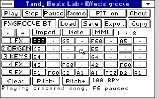
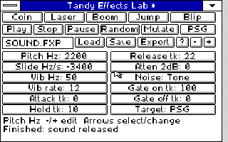
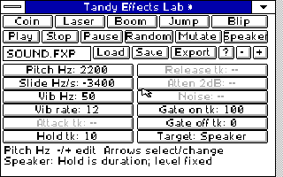
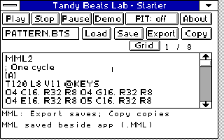
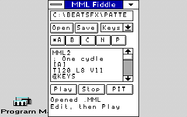
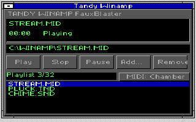

# OEMSound-Tandy

**Dr. DRAM's Tandy music lab.** Beats, sound effects, text scores and a music
player for **Windows 3.0 on the Tandy 1000 EX/HX**.

*DWA: DAWs With Attitude. Straight Outta LLMompton.*

Make a bass line, add noise drums, drop a laser onto a step, and let the PC
speaker join in. The Tandy's three tone voices, noise channel and speaker
become a little music workstation, all through one shared Windows sound driver.

  

<strong>Tandy Beats Lab · Effects groove · Five lanes, eight steps</strong>

**[Download Beats + Effects + Fiddle](https://raw.githubusercontent.com/astrobleem/oemsound-tandy/main/artifacts/win30/BEATSFX.ZIP)** ·
[Driver + Winamp installer](https://raw.githubusercontent.com/astrobleem/oemsound-tandy/main/artifacts/win30/TWSETUP.EXE) ·
[All downloads](docs/DOWNLOADS.MD) · [Installation](docs/INSTALL.MD)

## Make a beat

**Tandy Beats Lab** is the center of the suite: an eight-step editor with
three PSG tone lanes, noise percussion and an optional PC-speaker bass/effects
lane. Click cells to build a pattern, change pitches and tempo, then loop it.

- **Start with a groove.** Five original note patterns plus **Effects groove**
  give you something to play and take apart.
- **Turn effects into instruments.** Import an Effects Lab `.FXP` into a lane,
  place FX triggers on individual steps and transpose pitched effects.
- **Keep the whole song together.** Save a `.BTS` with its notes, triggers and
  embedded patches. You don't need to keep the original patch files beside it.
- **Stay in control.** Play, silent Pause/Resume and Stop, with keyboard shortcuts
  and cancellable preparation. Loops keep going until you stop them.
- **Take notes into Fiddle.** View, copy or export ordinary patterns as MML
  text scores. Songs with active FX triggers stay in `.BTS`, which preserves
  their sound shapes.

**Try it:** click **Demo** until **Effects groove** appears, then **Play**.
The laser, pitched-noise explosion and speaker jump play alongside normal
notes. Effects take time to prepare, especially after editing; **Esc** cancels.

[Beats controls and patch workflow](src/win30/BEATLAB/README.MD)

## Make the sounds, too

**Effects Lab** turns the same sound hardware into a small synth workbench.
Start with **Coin, Laser, Boom, Jump or Blip**, then shape pitch sweeps,
vibrato, envelopes, noise and gating. **Random** makes a variation;
**Mutate** nudges the current patch.

  
  

Save an editable `.FXP`, import it into Beats, or export compiled C data for
**libtandy**. PSG and PC speaker are separate targets: speaker effects use
pitch and on/off gating at fixed physical volume.

**A simple workflow:** shape a sound in Effects → save the patch → import it
onto a Beats step → save the complete song.

[Effects Lab guide](src/win30/EFFECTS/README.MD)

## Prefer notes as text?

**MML Fiddle** lets you edit and play a score directly. Beats exports MML2 for
PSG parts or MML3 when the optional `[P]` speaker part is used. Open the score
in Fiddle and change the notes, octaves, lengths and instrument commands.

  
  

Beats, Effects and Fiddle are all included in **BEATSFX.ZIP**, with original
patches, the Effects groove song, shared Setup and source.
[Launch paths](docs/APPS.MD) · [MML guide](src/win30/FIDDLE/README.MD)

## Just press Play

**Tandy Winamp** plays MIDI, Tandy VGM/VGZ, MOD arrangements, TND and AGI SND
files. Build a playlist and switch between the **Default** and **Chamber**
instrument banks for MIDI.

  

MIDI is arranged for the available chip voices. MOD playback is a PSG
square-wave arrangement, not sampled-instrument playback. Tandy VGM/VGZ uses
the supported PSG register stream.

[Get the driver + player](https://raw.githubusercontent.com/astrobleem/oemsound-tandy/main/artifacts/win30/TWSETUP.EXE) ·
[Player guide](experimental/WINAMP30/README.md) · [Supported formats](docs/FORMATS.MD)

The companion [instrument kit](docs/DOWNLOADS.MD) adds **Mini Piano** for mouse
or keyboard playing, **JoyMIDI** for joystick-controlled notes, and
**MiniMIDI** for a compact MIDI player.

## Get started

1. Download **BEATSFX.ZIP** and extract its complete `BEATSFX` folder, for
   example to `C:\BEATSFX`. Keep its files together.
2. Exit Windows to DOS. From that folder, run **TWSETUP** to install the
   shared sound driver and Winamp.
3. Run **GO** to start Beats, or **GOFX** to start Effects Lab. If Windows is
   somewhere other than `C:\WINDOWS`, pass its path, for example
   `GO C:\WIN30`.
4. In Beats, choose **Demo**, then **Play**. **F5** toggles Play/Stop,
   **F6** pauses/resumes and **Esc** stops.

To open Fiddle, stop and close Beats, then use Program Manager's **File → Run**:
`C:\BEATSFX\MMLFIDL.EXE`. Stop one sound app before playing another.

Already installed an earlier kit? Use the complete current BEATSFX folder
and restart Windows before launching it, so an older loaded audio DLL is not
reused. [Full installation guide](docs/INSTALL.MD)

### Requirements

- **Tandy 1000 EX or HX**, normal **640 KB** memory and **DOS 3.0 or later**.
- **Windows 3.0 in real mode**, with a working display setup.
- A desktop at least **320 pixels wide** for Beats and Effects Lab.
  [Windows XT](https://github.com/astrobleem/oemdisplay-tandy) provides the
  Tandy display drivers used in the screenshots.

The apps share one installed `SOUND.DRV`; no separate driver is needed for
each instrument. They include their own MIDI support rather than registering
a general WinMM `midiOut` device for arbitrary Windows MIDI software. Windows
3.1, protected mode and other Tandy/PCjr configurations are outside this kit's
supported scope.

## Under the hood

The shared driver brings the Tandy PSG into Windows sound calls and alerts,
while the apps add music and effects. Supporting apps can also use the PC
speaker as a square-wave voice. This is synthesized chip sound, not a General
MIDI sample bank.

[Source and build guide](docs/DEVELOP.MD) · [Earlier demos](docs/DEMOS.MD) ·
[License](LICENSE) · [Component licensing](docs/DEVELOP.MD#licensing)

Beats, Effects and Fiddle: fresh captures of the published kit in DOSBox-X,
Windows 3.0 real mode, 320×200. Winamp: current published player.
