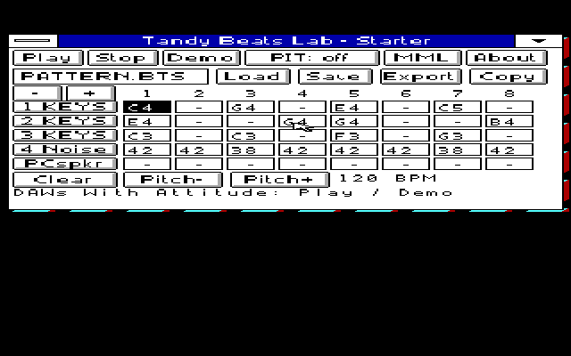

# Music tools for Tandy Windows

Beats Lab, Fiddle and the instruments use the same shared sound driver as
Winamp. Choose the companion apps you want:

| Kit | Apps |
| --- | --- |
| [MML3AUTH.ZIP](../../docs/DOWNLOADS.MD) | Beats Lab and Fiddle |
| [PITEXPR.ZIP](../../docs/DOWNLOADS.MD) | Beats Lab, Mini Piano, JoyMIDI and MiniMIDI |

Both kits include the same five-lane Beats editor, editable demos, pattern
Save/Load, MML export and native DOS Setup. Extract the complete kit and
follow [the shared installation guide](../../docs/INSTALL.MD#add-music-tools).

[App controls and launch paths](../../docs/APPS.MD) ·
[Beats guide](../../src/win30/BEATLAB/README.MD) ·
[Fiddle guide](../../src/win30/FIDDLE/README.MD)

The older source/evidence folders here retain their original versions.
Current downloads include matching source; [developer notes](../../docs/DEVELOP.MD)
identify the maintained copies.
