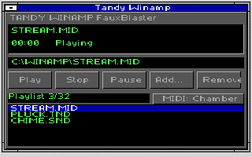

# Tandy Winamp

Play MIDI and Tandy chip-music files through the shared Windows sound driver.

[Download and install](../../docs/INSTALL.MD) · [All downloads](../../docs/DOWNLOADS.MD)

## Play a song

Start from DOS with `C:\WINAMP\GO`. Choose **Add...**, select a song, then
**Play**. The original STREAM.MID, SHORT.VGM, PLUCK.TND and CHIME.SND examples
are included. Type a path in the filename box or browse folders and drives.

The playlist holds 32 songs. Use its scrollbar or Home/End/Page Up/Page Down.
**Remove** changes the list without deleting the file; a removed playing
song continues until Stop or its end.

For MIDI, choose **Default** or **Chamber**. Winamp remembers the instrument
bank. MIDI supports sustain, volume, expression, pitch bend and controller
resets, with speaker bass and automatic PSG fallback.

VGM streams from disk. VGZ expands automatically, with progress and Cancel,
then uses the same playback path. MOD plays PSG square-wave arrangements,
not the sampled instrument timbres. [Full format details](../../docs/FORMATS.MD).

VGM/VGZ/MOD offer Pause/Resume. Play restarts a song. Stop and close the
player, then exit Windows normally to return to DOS.

## Setup and troubleshooting

[Installation, Repair and Uninstall](../../docs/INSTALL.MD) covers the current
native Setup. It installs the shared driver and every required helper.
For an opening error, use the status message and the supported-format guide.

[Developer build guide](BUILDING-UI.MD) · [Current validation record](../../tools/WINAMP/TESTS.JSN)
