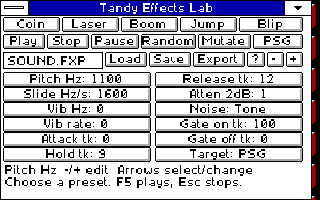

# Tandy Effects Lab

Make short PSG or PC-speaker sound effects using the same shared Windows
sound driver as the music tools.

[Download EFFECTS.ZIP](../../../docs/DOWNLOADS.MD) ·
[Setup and launch](../../../docs/INSTALL.MD#start-effects-lab)

## Make a sound

Choose **Coin**, **Laser**, **Boom**, **Jump** or **Blip** for an original
editable starting point. Presets preview immediately. **Random** makes a new
variation; **Mutate** nudges the current patch. Both use the patch's saved seed,
so the same starting patch and action give the same result.

Click a field to select it, then use **−/+** or Left/Right to change it and
preview. Up/Down selects the next enabled field. Pitch sweeps, vibrato,
attenuation envelopes, noise and on/off gating control real hardware output.
**PSG/Speaker** changes the output target; unsupported fields become disabled.
The speaker has fixed physical volume.

**Play/F5** starts from the beginning. **Pause/F6** is silent and keeps your
position; Resume continues. **Stop/Esc** releases sound. Tab/Shift+Tab moves
among the native controls and Space activates a focused button.

Attack, Hold, Release and gate lengths use 60 Hz ticks: 60 ticks is one second.
PSG attenuation runs from 0 (loud) to 15 (silent), in 2 dB steps. Speaker
effects use Hold for their duration, with pitch and on/off gating.

## Save and export

Enter an 8.3 filename such as `MYFX.FXP`. **Save/Ctrl+S** stores the editable
patch, target and seed beside the app; **Load/Ctrl+O** restores it. Replacing
a patch asks first and keeps the previous file as `.BAK`.

**Export** creates a same-name `.H` file with the compiled sound data for
libtandy. Existing exports are protected; choose another name to create a new
one. [C export and build details](BUILD.MD) describe the supplied FXPLAY.H adapter.

The complete kit includes the app, original PSG/speaker patches, shared DOS
Setup and matching source. Close Effects Lab and exit Windows normally when
finished. [Native validation](VALIDATE.MD) records the tested scope.
